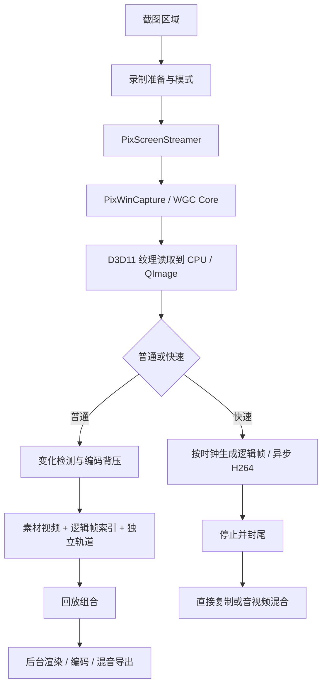

# PixPin 屏幕录制：链路、性能与交互研究

研究时间：2026-10-29～30。Lexift 源码对照基线：`main b29d7b9`。本轮只做竞品研究与文档整理，没有实现 Lexift 录制、修改依赖或提交 Git。

## 结论

PixPin 3.5.5.1 的录制不是静态截图的循环，也不是一条管线简单切换输出扩展名。普通模式保留屏幕素材、帧索引及独立轨道，回放时组合，导出时重新编码；快速模式按录制时钟持续编码 H.264，结束后复制文件或混音封装，跳过回放编辑。

已确认的主要优化是：WGC 自由线程帧池、复用采集实例与图像容器、画面变化检测、普通模式重复帧映射、编码队列背压、后台编码，以及针对不同编码器的低延迟参数。**没有证据支持“端到端零拷贝”**；实际链路包含 D3D11 Map 和逐行 `memcpy`，当前短时样本使用软件 x264。

研究以可复查的静态汇编、运行时计数、实际 MP4 解码和界面截图相互校验。菜单、类型名或字符串出现只证明该能力存在候选，不能单独证明运行采用。

## 1. 版本、方法与证据边界

- 本机安装版本：PixPin 3.5.5.1，EXE SHA256 `6dca2e4f183c02d02cb42c0756643cf525fd4c18ad1ff93727e815558da9416d`。
- 分析模块：`PixPin.exe`、`PixMovie.dll`、`PixAVCodec.dll`、`PixScreenManager.dll`、`PixWin32CaptureCore.dll`；另对 `PixWinCapture.dll` 做导出及运行调用核查。安装文件和被分析副本的身份核对保存在证据目录。
- IDA Free 9.4，MCP 1.1.3。本次没有可用 Hex-Rays；以下函数恢复基于汇编、导入导出、GUID 和数据文件，不能称为恢复原始 C++ 源码。
- REA 用于会话身份、汇编及运行时证据；Frida 只观察所选 PixPin 进程的调用计数、线程和编码器硬件标志，不修改业务返回值，不读取图像或识别正文。
- 性能样本不挂 Frida。100% 屏幕追加的调用核查挂有 Frida，只用于功能与链路，不与无钩子的 CPU 数据混比。
- 使用自建动态色条／计时／行号夹具；有效受控测试关闭麦克风和系统声音。初次探索误沿用系统声音开启，音频未作为研究数据保留，已将生成的探索成品替换为仅视频副本；原声音选项最后恢复。`normal-export-probe.json` 保留为旧探索文件的历史探针，已不代表替换后的仅视频文件，不用于当前性能或文件哈希结论。
- 本机有 125% 主屏及 100% 副屏，显卡包含 AMD 610M、RTX 4060 Laptop。**显卡存在不代表本次用了硬编码。**

证据根目录：忽略的 `target/pixpin-recording-research/`。`library-inventory.json` 保存模块摘要、完整导入导出及筛选字符串；`*-rea-evidence.json` 保留 REA Evidence 和限制。原始截图／素材／脚本／指标均不纳入源码提交。

## 2. 用户实际看到的流程

### 入口与准备

本机操作为：截图框选 → 点击摄影机图标 → 进入独立录制准备。准备后解除静态截图的全桌面遮罩，真实桌面和原应用可操作，区域保留蓝框。控制条初始靠近采集区域下边，独立于区域窗口，不把冻结截图继续铺在采集区。

准备条包含拖动柄、计时、FPS、录制、暂停、声音、键鼠动画／摄像头、标注工具和退出等。普通／快速模式在录制按钮旁的悬浮面板选择；不是进入设置页面才能切换。部分键鼠、摄像头或剪辑能力带会员标记，本轮没有绕过或验证授权能力。

### 录制与暂停

- 录制时区域框变红，录制按钮改为红色停止方块；暂停按钮仍可见。
- 暂停后框变黄，暂停图标改为继续；计时停住。受控样本停顿约 2 秒，输出时长未包含这段暂停。
- 控制条以紧凑横排承载状态，hover 才出现说明，不把大段操作说明常驻在工具条里。
- 范围窗口、动作条和提示是分离窗口；它们的 HWND、样式及几何保存在各截图配套 `*-windows.json` 中。不能据此断言 PixPin 与 Lexift 的辅助窗口策略完全一致。
- 官方提供工具条与区域重叠时隐藏／捕获排除相关策略；本轮有效采集将工具条放在区外，没有把“区外未入图”当作“区内排除已通过”。

### 普通完成：回放仍围绕原录制区域

停止后蓝色范围内显示录制内容，控制条上方出现时间轴，下面换成播放／暂停、时间、速度、声音、鼠标、键盘、输出格式、关闭、保存、全屏、复制等。**本机观察到的是区域回放及编辑控件，不是先弹一个通用文件播放器。**可重新录制；关闭时提示将删除本次录制素材。普通导出后本机仍保留回放会话，需要主动关闭。

实际跑通了普通 MP4 保存，文件可完整解码；未把“保存对话框可见”当成输出成功。会员剪辑、GIF／WebP 实际导出、音量编辑及实时标注的最终合成未在本轮穷举。

### 快速完成：先选目标，结束直接得到文件

实际弹出的模式说明明确列出：只支持 MP4、不支持键鼠动画、不能编辑视频边界和音量、结束后跳过回放直接导出。确认质量后，**录制开始前**选择保存目标；停止后经过收尾直接退出录制。

无声音受控样本的最终文件与 `Screen/screen_record.mp4` 临时编码文件 SHA256 完全相同，证明这一次完成没有再做整段视频重编码。存在声音时，静态代码改走音视频混合；本轮没有实测该分支的速度或同步精度。

界面关键帧见 `normal-ready.png`、`normal-start2.png`、`normal-paused2.png`、`controlled-playback.png`、`quick-warning.png` 和 `secondary-record-ready2.png`；`ui-contact-sheet.png` 是便于浏览的拼图，不替代原图。

## 3. 后端处理链路

### 3.1 采集：WGC，但仍有 CPU 读回

`PixScreenManager::createScreenStreamer` 创建所属区域的流；构造函数检查系统版本及区域是否被一个屏幕包含，建立 `PixWinCapture`。`captureTo` 优先调用 `captureToQImage`，没有相应实例时回退 `grabScreen → QPixmap::toImage`。`hasFrameChanged` 对正常流调用 `hasCaptureChanged`，回退路径直接视为变化。**跨屏／旧系统回退的性能不能直接套用本次单屏结果。**

WGC Core 创建 `GraphicsCaptureItem`，使用 `Direct3D11CaptureFramePool`：

- 帧池工厂 IID 的静态字节为 `589B103F-6BBC-5DF5-A991-02E28B3B66D5`，与 Microsoft `IDirect3D11CaptureFramePoolStatics2` 对应；其首方法是 `CreateFreeThreaded`。本地已安装的 `windows` 0.62.2 绑定同时核对了 IID 和 ABI。
- 帧池创建调用传入缓冲数量 **2**。这是该采集帧池的数量，不是整个程序只有两张图，也不是视频编码队列长度。
- 原生读取先尝试带 `0x100000` 的 Map，遇 `0x887A000A` 再以普通标志重试，之后按行 `memcpy`，最后 Unmap。这些常量符合 [Microsoft Map flag](https://learn.microsoft.com/en-us/windows/win32/api/d3d11/ne-d3d11-d3d11_map_flag) 与 [Map 契约](https://learn.microsoft.com/en-us/windows/win32/api/d3d11/nf-d3d11-id3d11devicecontext-map)。这是汇编与 ABI 对照得到的 API 归因，不是每个 Map 分支都做了运行命中统计。

这条链路明确存在 CPU 像素缓冲。不能从“WGC／D3D11／硬编码候选存在”推出端到端 GPU 纹理直接入编码器。

运行时受控普通录制观察到 294 次 streamer 读取、294 次 `PixWinCapture::captureToQImage`、294 次 Core 读缓冲，以及 294 次异步编码投递；线程为后台 TID 49036，当时 UI TID 为 4084。变化检测另外返回 false 582 次。计数属于这一有限窗口，不代表所有模式均相同。

### 3.2 普通录制：保存变化帧，时间线用映射恢复

`PixMultiTrackRecorder` 管理开始、暂停、停止和多个轨道。屏幕轨道的关键调用顺序在 `PixMovie.dll +0x37F70`：

1. 为请求的逻辑帧补索引，默认指向上一张素材。
2. 只有 `hasFrameChanged` 为真且 `PixAsyncEncoder::isBusy` 为假，才读入并投递新素材。
3. 尺寸不符时有缩放及性能告警；正常尺寸复用 QImage 容器。
4. 新素材编号写入该逻辑位置；无变化／繁忙时继续引用旧素材。
5. 周期性用 `QSaveFile` 写 `frame_indexes.dat`，不是把全部 RGBA 帧一直留在内存。

实际生成目录有 `Screen/screen_record.mp4`、`Screen/frame_indexes.dat`、`TrackManager.meta`、键鼠轨道及按配置开启的音频轨道。屏幕素材并不一定使用 FFV1：本机当前受控样本是 H.264 MP4；库中还存在 FFV1 解码及回退分支，不能说“所有普通录制都是 FFV1 无损存储”。

索引实测是版本 1、大端数量及素材编号。125% 受控普通样本：881 个映射项，仅 302 个不同素材编号，素材 MP4 也解码为 302 帧；最终成品却为 847 帧、14.116667 秒、60fps。**素材帧数和输出时钟是两层。**

`TrackManager.meta.actualRecordedFrames` 在此为 881，并不等于实际编码的 302 帧；`totalFrames` 为 847。两者具体时间基准转换还没有完整恢复，不能拿字段名直接计算实际捕获 fps，也不能仅据这组不同计数断言产品丢帧或计时错误。

回放侧加载映射，先得到素材编号，再解码和叠加独立轨道。存在缺索引时 1:1 回退、解码失败保留上一帧和重新初始化等分支；只是静态已发现，损坏恢复未做故障注入。

### 3.3 快速录制：按时钟补帧，减少结束后二次处理

`QuickScreenRecorder` 使用 `QElapsedTimer` 及 QTimer。帧处理函数 `PixPin.exe +0x2A3F20` 按累计活动时间计算目标逻辑帧编号；若已经赶上目标就返回，否则采集当前图像，把缺少的逻辑编号逐个交给异步编码器。投递失败会记录丢弃数。

这可以维持固定帧率和总时长，但补入的是当前画面，**不是恢复历史上漏掉的运动帧**。因此最终文件标记 60fps 不等于每秒捕获了 60 张不同内容。

开始创建 streamer、复用的 QImage 和 `PixAsyncEncoder`；暂停累计活动时间，停止时停止计时器并关闭编码。结束无音轨时走文件复制，有音轨时调用 `MixAudioVideoTracks`。异步导出使用独立 QThread。静态还发现某停止等待分支采用 `processEvents + msleep(5)`，不建议 Lexift 照搬这种嵌套事件处理。

### 3.4 编码、背压和硬件策略

`PixAsyncEncoder` 拥有后台 worker、受限队列及顺序协调。`isBusy` 检查 worker 队列长度；投递在关闭或满队列时拒绝。普通录制调用方收到繁忙信号后保留旧映射，快速路径统计未能投递的逻辑帧。没有依据把队列容量写死为某个通用值；工厂参数和模式会影响容量及 worker 数。

H.264 初始化在硬件启用条件下依次尝试 **NVENC → QSV → AMF → libx264**。实际设置代码包含：

| 编码器 | 静态确认的主要参数 |
| --- | --- |
| NVENC | `preset=p1`、`tune=ull`、`rc=constqp`、`qp` |
| QSV | `preset=medium`、`low_power=0`、`rdo=1`、`async_depth=4`、`look_ahead=0` |
| AMF | `usage=ultralowlatency`、`quality=speed`、`rc=cqp`、`qp_i/qp_p` |
| libx264 | `preset=veryfast`、`tune=zerolatency`、`refs=1`、`rc-lookahead=0`、`crf` |

这些参数表达了降低编码等待的取舍，不保证所有驱动接受，也不代表相同画质或最优压缩率。硬件测试还会创建编码器、检查硬件标志、编码测试帧，再解码检查，不只判断 DLL 是否存在。

本次运行时新建编码器的 `isUsingHardwareAcceleration` 返回 false；两种受控成品都带 `x264 - core 164 ...` 码流标识。故本机样本归为软件编码，不据显卡型号或模块加载猜测 NVENC 生效。没有执行硬件开启／关闭 A/B 或 GPU 利用率测量。

### 3.5 独立轨道、恢复和缓存

普通路径保留键盘、鼠标及声音数据，回放导出再组合；库中有 `WasapiCaptureThread`、系统／麦克风轨道和摄像头 Media Foundation 枚举。快速路径明确关闭键鼠动画轨道。

恢复管理保留录制区域、fps、时长及轨道元数据，普通屏幕索引使用原子提交。官网及静态代码存在中断恢复，但本轮没有强杀录制验证恢复成功，也没有验证磁盘满、设备丢失或音视频同步。

观察到素材落盘和队列约束不等于全程恒定内存：映射、轨道及编码器内部缓存仍会增长或保留。必须分别测磁盘、内存、队列及生命周期，不能把“没有保存全量 RGBA”说成“没有长时间录制成本”。

## 4. 本机性能样本及限制

有效对照只采用无 Frida 的 `normal-controlled` 与 `quick-controlled`：同进程、125% 屏幕、640×360、配置 60fps，动态 6 秒 → 静态 6 秒 → 暂停 2 秒 → 静态继续 2 秒。合成夹具本身的 CPU 不计入 PixPin 进程 CPU；系统／GPU／其他进程负载没有隔离。

CPU 是 `GetProcessTimes` 增量除以阶段墙钟，**100% 表示占满一个逻辑核**，不是任务管理器按全机归一化的百分比。每 100ms 采样 PrivateBytes 和工作集。各模式只有一个有效受控样本，不能计算可靠中位数／P95或宣称生产性能验收通过。

| 指标 | 普通 | 快速 |
| --- | ---: | ---: |
| 动态段 CPU／单核 | 22.4% | 22.7% |
| 静态段 CPU／单核 | 3.4% | 23.5% |
| 暂停段 CPU／单核 | 0.8% | 2.5% |
| 此段最大 PrivateBytes | 324.0MiB | 362.6MiB |
| 此段最大工作集 | 281.0MiB | 306.0MiB |
| 最终视频 | 640×360，847 帧，14.116667s | 640×360，848 帧，14.133333s |
| 最终视频编码 | H.264，60fps，软件 x264 | H.264，60fps，软件 x264 |
| 文件大小 | 117636 B | 271867 B |

内存是整个 PixPin 进程，模式顺序包含此前使用的素材、窗口和缓存；**不能把约 39MiB 差值当作快速模式固有额外缓冲**。画质／码率也未严格对齐，文件大小不是压缩效率排名。IO 计数受缓冲写入影响，不能以静态段写入为 0 断言没有编码或落盘。

125% 样本输入至红框分别约 150ms／354ms，快速起点为保存对话框确认、普通为录制按钮，起点不等价，且以边框判定，**不是首个可解码视频帧延迟**，不作速度排名。脚本中的 `source_available` 仅检查已存在的素材文件，不能当停止封尾完成。普通保存确认至文件稳定约 2.38s，包含 200ms 检查及 1s 稳定观测，不能当净编码耗时；快速收尾只做了短时观察，不报告精确 P95。

100% 副屏补做普通录制、暂停／继续、回放和调用核查。`normal-secondary-confirmed` 元数据活动时长 14.108s，294 个素材帧，Frida 调用与素材帧数对应；这组挂钩结果不纳入上表。更早的 `normal-secondary` 自动化没有建立干净起始边界，时长与预设脚本窗口不一致，保留原文件但排除性能结论。

两份有效最终成品均由独立 ffprobe 数帧并由 ffmpeg 完整解码。快速无声音临时文件与成品哈希相同，普通素材与成品不同。所有文件哈希见 `output-hashes.json`。

## 5. Lexift 应避免的坑

1. **先选择产品链路。** 快速 MP4 与可回放素材编辑的资源模型不同；不能先做“缓存全部帧”，最后再试图用一个保存按钮掩盖延迟和内存。
2. **时间戳优先于回调次数。** 采集时间、活动时钟、输出 PTS、暂停去时长和播放映射分别定义。静态内容仍占真实时长；积压不能让视频变快。补帧只维持时间，不能宣传为恢复丢失运动。
3. **先定背压，再接 UI。** 有界队列、最新帧替换、保留上一帧和失败策略都要可测。素材模式可重复映射，实时输出必须明确编码器忙时怎样推进 PTS。
4. **不要在 UI 或持锁范围等待采集／封尾。** PixPin 确实有后台采集与编码，但也有同步等待分支；可借鉴分工，不照搬 `processEvents + sleep`。
5. **捕获排除必须测区内浮动。** 蓝／红／黄范围框、控制条及提示持续可见，直接操作原应用。不能再次发生长截图初版隐藏范围框、预览不可读的问题，也不能只在区外摆工具条证明排除有效。
6. **不要先承诺 GPU 零拷贝。** PixPin 本身有 CPU 读回。Lexift 应先测捕获、读回、格式转换和编码占比，再决定是否引入纹理直通；把 GPU 型号、编码器创建成功、测试视频可解码分开验证。
7. **长截图采集能力不是现成录像时钟。** 当前 Lexift 连续帧只有 revision／变化 serial，没有采集时间戳，约 34ms 采样且默认不抓光标；长截图还约 30ms 轮询。直接按 serial/收到帧数输出会使静态时长缩水，固定 34ms 也不能满足真 60fps。
8. **素材和成品必须分开校验。** 普通模式素材只有 302 帧仍能导出 847 帧；只看源文件 fps、`actualRecordedFrames` 字段或 UI 的“60FPS”都会误判。
9. **先处理安全收尾。** 新鲜首帧、暂停、停止排空、容器封尾、写入失败、取消、迟到回调和设备失效都要明确；最终视频可解码才算成功。恢复文件属于敏感数据，应作独立产品选择，不能默认复制 PixPin 的落盘方式。
10. **性能验收需扩大样本。** 至少补静态／动态／文本滚动的 1080p、可接受的更大区域、长时录制、慢盘及编码阻塞；分别量队列峰值、CPU/GPU、PrivateBytes、写入量、真实运动更新率与结束耗时。保持范围显示和输入，不用隐藏 UI 或降低画质掩盖。

这些是研究后的设计建议，不代表 Lexift 已采纳或实现。当前不启动录制功能开发。

## 6. 证据索引

地址均带所属模块，不能把不同 DLL 同一个 image base 混用。以下是主要锚点；完整限制、参数及汇编以证据包为准。

| 内容 | 模块／地址 | REA Evidence |
| --- | --- | --- |
| 快速按时钟补帧 | PixPin.exe `0x1402A3F20` | `ev_6dc0849eb17c0e6525b4a7b64499a40c939ce521a5328fd3d55791e12524aa63` |
| 快速直接输出／混音 | PixPin.exe `0x1402A33A0` | `ev_3fea9cd38220466e6dd270ce205cb003bcccc2d4d4e69dfb25713b8e971873d2` |
| 硬件编码测试含解码验证 | PixPin.exe `0x1402A52E0` | `ev_a143124dea016ad6aad06cfd5ddacc3902a917b24c3cad321600a1b2400589c8` |
| 普通变化／背压／帧映射 | PixMovie.dll `0x180037F70` | `ev_876896ef641c8e2c3400b09c2f64570ea944ddc36a89c2cc28c1a354399995ed` |
| 索引原子提交 | PixMovie.dll `0x180038550` | `ev_0f2865a39abd8eba7ae4887bb7b8c0be8242ec99e9a389e8a02726cbf0be560f` |
| 编码器选择与回退 | PixAVCodec.dll `0x1800EC220` | `ev_06757b0ee07c8f36de6d1625ae4e2174d40b46b7fa8488a1a9ab3c8f54aac8bb` |
| 低延迟编码参数 | PixAVCodec.dll `0x1800ECC60` | `ev_7219e6fa1342be2641d440dc9a7e0eba3c6f14cf561a763dfde7d5512abd65f6` |
| 编码队列忙判断 | PixAVCodec.dll `0x1800F6790` | `ev_b21c47252ef1b96f0d055786780ad5c60338fc42aff5272daf91bd01fad67d7f` |
| 流采集与回退 | PixScreenManager.dll `0x1800085B0` | `ev_9f9505e199ef8dcec6c91f8fd6b4ab189928ec5df947716e3a073218b1ca4d2f` |
| 帧池配置与工厂 | Core DLL `0x1800098D0`、`0x180007580` | `ev_262e5be7542d30f000faf4f46dd061e30b9eb216c7c4ed8847857927fd78ef0d`、`ev_2d7b85a642b001323f2ca5797790d79390235fb3f1d8f0a018dc3f08700f7923` |
| D3D11 读回与逐行拷贝 | Core DLL `0x18000ACB0` | `ev_98ce6c4cdccf1307e4abd3c36585a0a83f58ab74abdfe5755e7d53e9f41f9cf3` |
| 实际后台调用及软件编码标志 | PixPin PID 9832，有限钩子观察 | `ev_4004b627567ddfc66be5a1826e05289cfc04b9f92acbf321b660923aa8760cca` |

官方产品依据：[屏幕录制](https://pixpin.cn/docs/capture/gif-capture2)、[开始使用](https://pixpin.cn/docs/start/quick-start)、[3.5.5.1 更新日志](https://pixpin.cn/docs/official-log/3.5.5.1)。官网“优化／GPU／恢复”描述是产品声明，不当作本机测量；滚动更新的手册可能覆盖比 3.5.5.1 更新的行为。

## 7. 本轮未覆盖

- 无 20 次以上统计、1080p／4K 性能、长时增长或多显卡硬件加速 A/B；不提供这些场景的 FPS、P95或泄漏结论。
- 100% 屏幕验证普通路径，未同样跑快速模式；跨屏选区及 DPI 热切换未测。
- 不量化每个 D3D11 Map／读回／编码阶段耗时；帧池为 2 不推导整体队列容量。
- 没有做源码级完整控制流恢复；普通两个帧计数字段的时间基准转换、所有缓存和队列参数仍有未知。
- 音频同步、摄像头、键鼠动画、实时标注导出、GIF／WebP、会员裁剪及暗色／全语言布局没有作为本轮原生验收。
- 工具条区内排除、远程桌面、HDR、受保护内容、设备拔除、磁盘满、编码失败、中断恢复、连续 20 轮资源释放没有故障注入。

上述未知不阻止当前研究形成实施依据，但不能写成产品能力已验证。后续计划应先通过采集时钟、背压、完整解码及界面排除技术门槛，再接用户入口。

## 8. Lexift 技术门槛反馈

对应执行与证据见 [屏幕录制技术验证](../releases/screen-recording-gate.md)。本节是本项目验证所得，不是对 PixPin 后端实现的新增断言；不能据此声称 PixPin 使用 Media Foundation Sink Writer。

- 独立 WGC 显示器实例、最新帧替换及软件 H.264 已验证能达到单屏 1080p30，不需要将截图／效果取样器改造成录屏服务。暂停必须扣除活动时间，继续必须验证新鲜帧；静态重复和真实内容更新率分别统计。
- 硬件能力必须逐个实际绑定，并完整解码检查帧级色彩与像素。本机 AMD 候选的媒体类型协商正确但码流色彩标记不合格；NVIDIA 的两屏各 20 轮视频正确，但原生退役句柄持续增长，未通过生命周期资格。软件 1080p30 必测门槛通过，当前正式首版应只采用软件；不能只凭模块名、文件可播放或吞吐判定硬件合格。
- 原生覆盖窗口在显示前设置身份及捕获排除，并始终显示范围框，区内真实点击、拖动和滚轮可达下层应用。无需每帧隐藏界面；实际任务栏属于桌面内容，不能误当成范围层污染。
- 真实受控字节流写入失败可直到 Finalize 才暴露；正式入口须将封尾和最终发布纳入成功定义，保存失败不得留下成功状态。取消使结果失效，但不创建替代线程绕过阻塞的原生调用。
- 原生接口引用计数、GPU／编码器内部缓存与进程工作集应分别观察。所属 Lease 归零不等价于驱动资源回到基线，长测诊断也必须流式写入，避免测量代码本身持续增长。

正式首版建议仍限单屏、无声 MP4、手动暂停／继续／完成／取消。先以通过技术门槛的软件编码为保底，硬件仅接入完成颜色、解码及生命周期验收的候选；不在同一文件中静默切换实现。正式接入时再由 Core 管理任务、App 调度、Platform 持有原生资源、UI 展示状态；不能直接公开本轮 cfg(test) 驱动作为产品 API。
