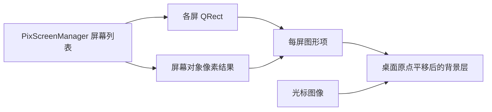

# PixPin 截图功能研究与 Lexift 实现拆解

2026-10-20 长截图专项补充：已新增[长截图链路与交互研究](pixpin-long-screenshot-research.md)，包含本机采集范围框、局部预览增长、完成编辑器、直接复制及拼接函数的 IDA 证据。下文早期“长截图未实测／匹配方法未恢复”只代表原研究轮次，专项记录更新了这部分覆盖；不扩大其他未实测项。

研究日期：2026-10-16。Lexift 实现状态更新：2026-10-26。状态：已完成功能研究、局部静态调用链、Lexift 逐项实现拆解及原生自动化主流程取证；竞品硬件组合与高级功能的未实测范围见第 5 节，Lexift 新增能力的验证边界见下表。

主要结论：Lexift 已具备静态截图和可编辑贴图的基础，不应重新实现一套编辑器。选区键盘微调、手动宽高输入及左下角操作提示已完成；比例锁定已接入本次截图的鼠标、键盘和尺寸草稿；冻结帧取色、像素放大镜及顶层窗口候选已接入；截图选区 OCR 复制已接入；内部元素按点异步识别与滚轮层级切换已接入，支持范围受 UIA 提供者和有界预算限制。本次运行内复用最后成功图片输出的选区已接入，首次框选按 R 使用新底图；图片历史另以进程内 20 条／512MiB 保留可编辑资源，退出清空。长截图和录制需要独立的连续采集与处理生命周期。本机 PixPin 的截图→标注→贴图→拖动→PNG／复制已自动跑通，复制与 PNG 像素一致。

### Lexift 后续实施进度

下表更新本项目的工作树及项目 Release 状态，不改变后文 PixPin 的原始证据和实测范围；具体完成标准与未覆盖项以对应验证记录为准。

| 能力 | 当前状态 | 依据与剩余范围 |
| --- | --- | --- |
| 截图选区键盘微调 | 已实现并完成项目 Release 实测 | 方向键移动 1px、Shift 10px、Ctrl 调整宽高，支持连续按键、取消及失焦清理；仅截图编辑的鼠标模式生效，不进入标注撤销历史。见[键盘微调验证](../releases/screenshot-keyboard-adjustment.md) |
| 左下角操作提示与接近隐藏 | 已实现并完成项目 Release 实测 | 框选／鼠标／绘制三组提示，16px 隐藏、24px 恢复；与选区同帧，不进入图片输出。完成双屏、菜单及矩形绘制检查，12 种语言与浅深主题组件渲染；未穷尽全部原生工具交错。见[操作提示验证](../releases/screenshot-help.md) |
| 手动宽高输入 | 已实现 | 点击尺寸标签编辑宽高草稿，确认后固定左上角应用，超出桌面自动截断；与键盘共用边界，不影响标注历史；紧凑面板支持标题栏拖动，见 [面板验证](../releases/screenshot-size-panel.md)。见 [宽高输入验证](../releases/screenshot-size-input.md) |
| 比例锁定 | 已实现 | 尺寸草稿捕获比例，应用后统一约束八方向鼠标缩放、键盘及数值调整；固定已确认锚点，不跨截图记忆。见 [比例锁定验证](../releases/screenshot-aspect-lock.md) |
| 冻结帧取色／像素放大 | 已实现，验证范围见记录 | 首次框选及截图鼠标模式显示 15×9 物理像素网格，C 复制大写 HEX；采样冻结底图，不含截图新增标注和装饰，见 [像素放大镜验证](../releases/screenshot-pixel-picker.md) |
| 顶层窗口候选 | 已实现，验证范围见记录 | 悬停预览、单击进入编辑，超过 4px 逻辑距离转自由框选；同次截图冻结候选，内部控件见下一项，见 [窗口自动框选验证](../releases/screenshot-window-candidates.md) |
| 贴图锁定与鼠标穿透 | 已接入，验证边界见专项记录 | 每实例独立锁定／穿透，托盘逐张恢复；不修改文档或输出。见[交互策略](../features/pin-interaction.md)及[验证](../releases/pin-lock-passthrough.md) |
| 贴图透明度 | 已接入，验证边界见专项记录 | 右键五档透明度，编辑时保留，控制反馈独立；穿透与截图挂起恢复保留确认值，成品不受影响。见[交互策略](../features/pin-interaction.md)及[验证](../releases/pin-opacity.md) |
| 贴图统一隐藏／恢复 | 已接入，验证边界见专项记录 | 托盘批次隐藏已有贴图，新贴图正常显示；恢复保留窗口策略、不激活，截图恢复不解除用户隐藏。见[显隐规则](../features/pin-interaction.md#统一隐藏与恢复)及[验证](../releases/pin-visibility.md) |
| 贴图 OCR 复制 | 已接入，验证边界见专项记录 | 识别已确认裁剪底图；保留贴图及编辑，共用长图分块检测，不按字符串去重。见[贴图 OCR](../releases/pin-image-ocr.md) |
| 截图 OCR 复制 | 已实现，验证范围见记录 | 识别冻结底图选区，复制文字；成功、空结果或失败均退出截图并显示 toast，不自动翻译，见 [截图 OCR 验证](../releases/screenshot-ocr.md) |
| 内部元素候选与滚轮层级 | 已实现，验证范围见记录 | 已改为所属窗口内的有界后台按点 UIA 查询，首帧不等元素；点击采用已呈现范围，结果过期隔离。新验证见[按点优化记录](../releases/screenshot-point-query-performance.md)，[冻结快照验证](../releases/screenshot-element-candidates.md)作为历史记录 |
| 上次选区复用 | 已实现并完成项目 Release 双屏实测 | 复制、PNG 保存、贴图成功记录物理区域；首次框选按 R 复用新底图，布局改变时禁用，重启清空。已补齐保留并聚焦贴图后的激活交接，两屏各连续 10 轮通过；不是图片历史或多条区域列表。保留贴图回归及未覆盖范围见 [区域复用验证](../releases/screenshot-region-history.md) |
| 截图进入编辑的键盘焦点交接 | 已修复并完成项目 Release 双屏实测 | 三种选区提交入口共用源身份和输入屏幕快照，编辑反馈首帧完成后一次转交焦点，再销毁旧宿主；提交后的迟到宿主激活失效，外部前台变化撤销交接。见[编辑焦点验证](../releases/screenshot-editor-focus.md) |
| 首次截图准备 | 已改为按点采集，重复性能目标未全部达到 | 后台 bootstrap 预处理、多屏分阶段组同步；三屏整帧观测首次／重复 P95 为 329.29／321.92ms，重复 ≤250ms 尚未达到，见[按点优化记录](../releases/screenshot-point-query-performance.md)，[前轮准备性能](../releases/screenshot-startup-performance.md)保留历史口径 |
| 手动纵向长截图 | 已实现首版并完成本机验证 | 单屏实时采集、持续范围反馈、尾部局部预览、暂停／继续、直接输出及独立图片编辑；不自动滚动或裁剪固定栏，见[重做验证](../releases/screenshot-long-redesign.md) |
| 长图结果编辑器裁剪 | 已接入，验收范围见记录 | 非破坏矩形裁剪，与标注共用撤销／重做，保持原图坐标和效果采样；复制／保存／贴图使用确认范围，见[裁剪验证](../releases/long-image-crop.md) |
| 贴图编辑裁剪 | 已接入，验证见记录 | 完整可编辑底图与显示范围分离，非破坏裁剪和共享历史；裁剪长图贴图可扩大恢复完整长图，见[贴图裁剪验证](../releases/pin-image-crop.md) |
| 图片历史 | 已实现 | 本进程 20 条／512MiB，保留可编辑底图与确认范围，同源成功输出更新；见[图片历史验证](../releases/screenshot-image-history.md) |
| 屏幕录制 | 待实现 | 与截图独立的时钟、连续采集及编码生命周期，竞品菜单或静态字符串不代表 Lexift 已具备这些能力 |
| 贴图旋转／翻转 | 已接入，验证边界见记录 | 普通与编辑贴图菜单四种方向操作，共享非破坏历史、中心定位、后台候选提交；锁定时全部禁用。见[专项验证](../releases/pin-image-transform.md) |
| 贴图倍率与编辑视口 | 已接入，验收边界见记录 | 普通显示提供物理倍率和适应工作区；编辑使用有界视口平移和局部放大，复用原 HWND、坐标和原始输出。见[交互说明](../features/pin-interaction.md#贴图倍率与编辑视口)及[验证](../releases/pin-image-zoom.md) |
| 贴图灰度／反色 | 已接入，验收边界见记录 | 独立勾选、共享历史、完整成品处理及处理后底图 OCR；保留原资源和视口。见[交互说明](../features/pin-interaction.md#灰度与反色)与[验证](../releases/pin-image-color.md) |
| 贴图亮度 | 已接入，验证边界见专项记录 | 九档非破坏亮度，位于灰度／反色之后；共享历史、后台候选、输出和 OCR，不影响窗口几何或透明度。见[交互说明](../features/pin-interaction.md#亮度)及[验证](../releases/pin-brightness.md) |
| 贴图对比度 | 已接入，验证边界见专项记录 | 九档非破坏对比度，位于灰度／反色之后、亮度之前；共享历史、候选和输出，最高增益为 2 倍。见[交互说明](../features/pin-interaction.md#对比度)及[验证](../releases/pin-contrast.md) |
| 独立编辑器颜色菜单 | 已接入，验证边界见专项记录 | 长图、导入及历史共用右键四项颜色与单步恢复；保留视口、工具和选择。见[功能](../features/image-editor-colors.md)及[验证](../releases/image-editor-colors.md) |
| 外部图片导入 | 已接入，验证边界见专项记录 | 工具条／托盘打开 PNG／JPEG 编辑，或从剪贴板直接贴图；成功输出才记历史，不修改 R。见[导入说明](../features/image-import.md)与[验证记录](../releases/image-import.md) |
| PNG／JPEG 保存 | 已接入 | 全部图片保存入口统一支持，PNG 默认，JPEG 95% 质量及白底；见[保存格式验证](../releases/image-save-formats.md) |

## 1. 阅读边界与证据

本文研究可观察行为及 Lexift 的独立实现方案，不把 DLL 名称、字符串或反汇编当作原始源码。下文标记：**文档**为官方说明，**静态**为本机程序证据，**源码**为 Lexift 当前实现，**建议**为待实现设计。官方在线说明可能高于本机安装包，不能将在线说明全部视为本机已实测行为。

### 本机分析对象

- 原文件：`C:/Users/lizhen/AppData/Local/Programs/PixPin/PixPin.exe`，23,662,904 字节，PE x86_64。
- SHA-256：`6dca2e4f183c02d02cb42c0756643cf525fd4c18ad1ff93727e815558da9416d`。
- 安装注册信息为 **PixPin 3.5.5.1**，InstallLocation 与上述目录一致；快照见 `target/pixpin-analysis/installed-version.json`。这是安装元数据证据，尚未由运行中的 About 页交叉核实。原文件 Authenticode 检查为 Valid。
- 分析副本：`target/pixpin-analysis/artifacts/PixPin.exe`；IDA 数据库也仅存于该忽略目录。
- 引擎：IDA Free 9.4，原生 MCP 1.1.3，经 REA 6.5.0 attached/native 适配访问。已经成功查询字符串、交叉引用和汇编；没有取得伪代码。未调用云反编译、未上传程序。
- 完整本轮证据包：`target/pixpin-analysis/ida-evidence-20261016.json`。它是本地证据，不随 Git 分发。

| 编号 | 可复核证据 | 能证明什么 / 不能证明什么 |
| --- | --- | --- |
| S1 | `ev_29c8ed26e7ec897b0c1fad6f023c5cb72d358690d42fa9498576158f14ca9854`，`search_strings("screenshot")`，253 项 | 存在截图动作、历史、区域模式、刷新与生命周期相关文字；不证明所有功能在当前授权下可用 |
| S2 | `ev_31349d79f8cf2807601a6a4e9cf9dbe4074c4a7abc0baab062e428e89da1cdb6`，字符串地址 `0x140d0a730` 的引用为 `0x1402bbeb4` | 将 `beginCaptureAreaEdit` 日志绑定到实际代码引用 |
| S3 | `ev_6f120f5628ba711a407e7d55bdd20939d960b37e539a3f55b2393ad776585ca2`，函数 `0x1402bbc00` 汇编 | 可见 Qt 对象引用存活检查及 `QTimer::singleShotImpl` 调度；字段含义和完整状态枚举仍未恢复 |
| S4 | `ev_2a0a51e4a4a2cf60c7a95268c34870d04eed3573fec12311ca8d958cbc65a272`，搜索 `3.5.` 无匹配 | 仅说明 IDA 已定义字符串内未找到该文本，不能据此确定版本 |
| S5 | `ev_82e90f42b0b538cfa64236ed5827628884464a23cb255de9ad87fd016411d61d`，精确版本形状正则 | 匹配到 Qt 等组件版本，不能拿这些字符串当应用版本 |
| S6 | `ev_d8bb454d9ddadfbf918b20b7b5a380eacd2f36b51f00cd12da7b817f6c57bd90`，函数名搜索 capture | 仅有两个上下文捕获函数名，不能证明屏幕采集 API；无符号名称搜索覆盖有限 |

### 官方来源

- [D1 静态截图](https://pixpin.cn/docs/capture/static-capture)：入口、识别、选区、输出与历史。
- [D2 截图配置](https://pixpin.cn/docs/configuration/screenshot)：HDR 策略、UI 检测、辅助线及录制配置。
- [D3 几何标注](https://pixpin.cn/docs/mark/geo)：几何参数、旋转、扇形、弧形、二次调整。
- [D4 马赛克与智能擦除](https://pixpin.cn/docs/mark/mosaic)：三类图像处理与自动匹配遮挡。
- [D5 标注橡皮擦](https://pixpin.cn/docs/mark/erase)：标注覆盖擦除及二次编辑设置。
- [D6 长截图](https://pixpin.cn/docs/capture/long-capture)：滚动拼接流程与失败条件。
- [D7 屏幕录制](https://pixpin.cn/docs/capture/gif-capture2)：两类录制、回放与输出。
- [D8 图像贴图](https://pixpin.cn/docs/pin/image)：图片来源、识别、图像处理及裁切。

官方示意图可在以上页面直接查看；本文没有把官网演示图标记为本机测试截图。部分页面抓取超时，尚未据其正文作结论。

## 2. 截图如何工作

### 可确认的交互链

依据 D1、D6、D7，可将产品行为理解为：触发 → 准备画面 → 选择区域 → 调整/标注 → 复制、保存或贴图；长截图和录制从选区转入各自会话。这个分解是行为模型，不是声称恢复了 PixPin 的类设计。

S1 中的 `ScreenShotView`、`prepareScreenShotBgLayer`、`refreshScreenShot`、`beginCaptureAreaEdit` 提供了定位入口。S3 进一步显示：函数先判断对象及状态，取得 Qt 对象外部引用，在调用选区相关子函数后重新验证引用；一个分支设置标志并调用子函数，随后通过零延时 QTimer 回调继续执行。失败分支输出对象销毁或操作过期日志。这支持“选区调整与工具条状态交接需要防重入、防失效回调”的判断。

仍不能从这些证据确定：底图具体采集 API、每屏窗口数量、渲染线程、尺寸标签是否与边框同帧、遮罩缓存策略、拼接匹配算法及 OCR 模型。安装目录虽有 Qt、捕获、视觉、OCR 和编码模块，但名称不能证明实际执行路径。

### 捕获与识别的静态模块边界

进一步读取了 8 个 PE 文件的普通导入目录；完整结果及每个文件 SHA-256 在 `target/pixpin-analysis/pe-imports.json`。解析依据 PE section 的 RVA→文件偏移映射、Import Descriptor 和 64 位 thunk，不加载 DLL、不执行目标。此处未覆盖延迟导入或运行时动态解析，不能把未列出的 API 判作不存在。

| 直接观察 | 可以得出的结论 | 仍需验证 |
| --- | --- | --- |
| 主程序从 `PixScreenManager.dll` 导入 `grabScreen`、`createScreenStreamer`、`captureTo`、`updateArea` | 产品存在屏幕管理、一次抓取与流式帧接口边界，超出了“目录里有一个捕获 DLL”的证据强度 | 哪些界面调用哪条路径，线程和帧缓存策略 |
| ScreenManager 导入 `PixWinCapture` 的 Static/非 Static 类；还导入 Qt `QScreen::grabWindow` | 具备多种捕获接口，不能将全部截图一概称为同一种采集技术 | 兼容模式/HDR/窗口截图的实际选择条件 |
| `PixWinCapture.dll` 导入 `PixWin32CaptureCore` 的 prepare/captureToBuffer/release/getExpectedImageSize，另有 DXGI 工厂及 D3DCompile | 原生像素缓冲、尺寸查询与生命周期被隔离到 Core 适配 DLL | 不能只凭 DXGI 导入断言使用 Desktop Duplication；也不能仅凭 Windows 专用名称断言 WGC |
| 主程序直接导入 GDI `BitBlt`、USER32 `PrintWindow/GetDC` | 这些系统能力在程序中有静态绑定 | 尚未追踪到具体截图分支；可能用于其他窗口操作或回退 |
| UiRegionDetector/UiSpy 导入 OLEACC、`WindowFromPoint/ChildWindowFromPoint`、坐标转换 | 窗口/可访问性候选检测具备原生接线，符合官方 UI 检测行为的可能实现边界 | 具体控件树算法、查询线程、权限失败回退仍未知 |

因此 Lexift 可以借鉴“显示器/坐标管理 → 可取消采集 → 不可变像素结果 → 共用编辑/输出”的职责划分；具体实现继续使用自己的 ScreenCapturePort，不复制私有 DLL 接口。尝试用 REA 按导入名寻找引用时，IDA adapter 返回 `list_names` 不支持，未假装已经取得该调用链。

### 本轮补充：首次准备与区域识别

2026-10-18 重连 IDA，核对同一 PixPin.exe 摘要后取得以下静态调用证据，完整记录在忽略的 `target/pixpin-analysis/screenshot-startup-evidence-20261018.json`：

- `0x1402DA760` 调用 `AsyncGetWinRectByPoint`；`0x1402DE350` 的滚轮分支分别调用异步父／子区域查询。
- `0x1402D69B0` 创建检测器，读取 `getFirstRect`，随后连接 `sigNewRectDetected`；未取得首结果时有 `msleep(1)` 与 `processEvents` 循环。不能将其描述成完全不等待，也不照搬事件泵重入。
- `0x1402C2940` 创建背景图形项并调用 `0x1402C7DC0` 更新多屏背景。该函数伪代码失败，结论来自汇编；不将失败输出视为完整反编译。
- 调用端可确认按位置请求及首结果交接；DLL 内部是否完整预扫描、底层抓图 API、线程等待的实际成本仍未确认。实测与实现优化见[首次准备验证](../releases/screenshot-startup-performance.md)。

2026-10-18 的 Lexift 版本采用“整窗及底图先显示、元素校验后补充”，首轮 80ms、后置 250ms；这套冻结元素策略已被本轮后台按点查询替代，当前规则见下文及[验证记录](../releases/screenshot-point-query-performance.md)。快采集与纹理准备优化来自 Lexift 源码和测试，不冒充 PixPin 已恢复的实现。

### 已追踪的多屏背景准备代码

按 PE 导入表计算 IAT 地址后，可以绕过该 adapter 的名称枚举限制，直接查询地址引用；下面是静态调用证据，不是运行时跟踪。

| 证据 | 观察 |
| --- | --- |
| `ev_a3468f02dd7da8ea61ce9b6754f048c11d84ed7b19c7b612ef8adf4375aa659f` | `grabScreen` IAT `0x140ccae20` 有 7 个去重引用，包括 `0x1402b76f5`；原始列表重复项不是额外调用 |
| `ev_148dd10c32f40e584958e87c7a816ec92a10168aa22dfd432ee9f48cb9d8a40e` | 包含 `0x1402b76f5` 的函数调用 ScreenManager instance/grabScreen，接收 QPixmap；还取得 wholeRect 并构造 UiRegionDetector。说明抓图和 UI 候选检测在此路径汇合，尚不能把此路径等同所有截图入口 |
| `ev_54541104c20acc251db694d1234aa513da48af43ed7565c2e2542c51b1cb34c7`、`ev_2e7325b7af0d8f3af8305cae5a96300107a0dd5a30c31f57a1b4d12cb34df965` | 背景准备完成日志实际引用到函数 `0x1402c2940`；该函数构造 QGraphicsItem，并两次调用 `0x1402c7dc0` |
| `ev_d3f4344a7e3a9e4e6622db770eaed00a27bd7a2ec255ef11b50c5e3cc604adce` | `0x1402c7dc0` 遍历 ScreenManager screenList，按索引复用/创建 QGraphicsItem，保存各屏 QRect，变化时调用 prepareGeometryChange；在布尔分支内逐屏更新；取 wholeRect.topLeft 的负值设置父图形项位置；另一分支调用 PixCursorPixmap::GetCursor |
| `ev_d40d989c2ab830dbd16eafe84d663629e67c42779263d268aa19a833b6ec85fa` | 逐屏子函数 `0x1402c79d0` 通过屏幕对象虚表偏移 8 取得结果，赋给本图形项 QPixmap 并检查 isNull；尚未解析虚表具体实现，不能声称已经找到最终系统 API |
| `ev_c7cd912a5ecde3068c3b362c7c3f7f379d2ef9e5e526e28c2daf09ab119bbab0` | 流式 createScreenStreamer IAT `0x140ccae38` 的去重引用为 `0x1402a2e2f`，尚未追踪所属会话 |

以上足以支持这个局部结构：**显示器列表 → 每屏矩形/像素图 → 父级桌面坐标平移 → 背景图形层**。它不能证明原生窗口数量、GPU/CPU 渲染器、线程、选区反馈同帧或最终系统采集 API。Lexift 现有每屏物理范围和冻结帧合成已经有相同的职责边界，重点应是保持帧/几何版本一致，而非照搬 Qt 图形项。

图仅表达上述已检查函数的局部关系，不表示已恢复整个应用架构。

### Lexift 已有对应链

2026-10-19 补充：[截图启动 DLL 深入分析](pixpin-startup-ida-analysis.md) 已追通顶层快照后按点 MSAA／HWND 查询、同类请求合并、局部区域缓存，以及 WGC + D3D11 静态采集分支、CPU 回读和 3 秒空闲释放；它细化此前底层未知部分，不证明本机每次基准走过该分支，也不改变现有性能统计。

- [Core 截图状态机](../../crates/lexift-core/src/domain/screenshot.rs)：`ScreenshotPhase`、`ScreenshotEvent`、`ScreenshotCommand`，准备、框选、编辑、输出和恢复；会话及操作身份防止旧结果生效。
- [App 截图调度](../../crates/lexift-app/src/screenshot.rs)：`execute`、`prepare`、`output_image`，采集、合成与输出接线。
- [冻结编辑控制器](../../crates/lexift-ui/src/annotation/frozen_editor.rs)：`Editing`、`input`、`render`，截图和贴图复用不可变底图编辑预览。
- [选区模型](../../crates/lexift-core/src/domain/region_selection.rs)：`RegionSelection`、`RegionEditor`，四方向创建、移动、八向缩放，以及键盘物理像素调整和取消快照。
- [截图 UI](../../crates/lexift-ui/src/annotation/screenshot.rs)、[预览](../../crates/lexift-ui/src/annotation/screenshot_preview.rs)：同帧选区反馈、尺寸标签及操作提示，不需要另造截图编辑器。

## 3. 功能逐项拆解

表中“已有”只表示源码存在，不代替当前 Release 实机验收。方案保持 7 个 crate；窗口接线由 App 注入，领域规则归 Core，系统能力归 Platform。

### 3.1 入口、选区与辅助反馈

| 功能与证据 | Lexift 实现方向 | 验收重点 |
| --- | --- | --- |
| 触发截图、延迟与预设（D1；S1 的 `delayScreenShot`、preset） | 复用现有截图请求；延迟任务归运行时，Core 记录请求身份；预设仅保存位置/尺寸/延迟，不保存屏幕正文 | 重复触发、延迟取消、显示器变化、退出时取消 |
| 手动矩形与八向调整（D1，源码已有 RegionEditor） | 保留现有物理像素模型及取消快照；不把截图选区做成标注对象 | 反向拖动、零面积、负坐标、跨 DPI、捕获丢失 |
| UI 元素/窗口吸附，滚轮切换层级（D1/D2） | Platform 后台查询元素及窗口矩形；Core 接收候选身份/范围；UI 只画候选，保留手动回退。不能同步阻塞鼠标热路径 | 不提供可访问接口、权限不同、目标关闭、旧查询晚到 |
| 自由、多边形、多窗口和区域加减（S1；3.5.5.1 正式更新说明，尚未实测） | 扩展 Core RegionGeometry 为路径/组合区域；预览和输出共享覆盖计算；不要仅改选择框外观 | 多区域并集/差集、孔洞、透明裁切、跨屏输出一致 |
| 像素级键盘微调（D1；Lexift 已实现） | RegionEditor 已提供物理像素移动、固定左上角调整尺寸及取消快照；UI 按会话与窗口转发未消费按键，不注册全局方向键钩子 | 1px／10px、边界、极小选区、多键与修饰键、取消；选区不进入标注撤销历史。验证见本文进度表 |
| 手动尺寸（D1；Lexift 已实现） | 鼠标模式点击同帧尺寸标签打开宽高草稿，确认后固定左上角应用；RegionEditor 与键盘缩放共用边界限制 | 整数校验、1px 最小值、自动截断、取消、过期帧命中；见 [验证记录](../releases/screenshot-size-input.md) |
| 比例锁定（D1；Lexift 已实现） | 尺寸面板捕获当前草稿比例，应用后由 RegionEditor 统一约束鼠标、键盘及数值调整；不跨截图记忆 | 锚点、整数舍入、联合边界、草稿取消及混合输入；见 [验证记录](../releases/screenshot-aspect-lock.md) |
| 尺寸标签、辅助线、像素放大与取色（D1/D2） | 标签已有；取色从冻结帧按物理坐标采样，邻域最近邻放大；颜色格式为纯转换，复制经 ClipboardPort | 标签不入输出；边缘采样；125% 下不误采逻辑像素 |
| 阶段操作提示与接近隐藏（用户提供的 PixPin 截图；Lexift 已实现） | 共用 Slint 提示组件和缓存纹理；只按鼠标及活动几何避让，框选宿主与编辑交互帧复用，不创建独立可见提示窗口 | 跨屏单份显示、16px／24px 迟滞、结束操作恢复、模式／输入变化、输出不含提示；不把参考图中的未实现快捷键一并加入 |
| 光标是否进入图片（D1/D2） | 采集结果单独携带光标图像、热点与位置，在合成阶段可选叠加，不能截工具条自身光标装饰 | 热点、跨屏、透明光标、导出与预览一致 |
| 刷新底图（S1 的 refresh 与连续刷新提示，尚未实测） | Core 增加刷新操作身份；App 替换冻结帧；明确定义是否保留选区和标注；旧采集不得覆盖新底图 | 刷新中取消、效果取样失效、窗口销毁 |
| HDR 模式（D2） | 在现有 ScreenCapturePort 适配内保留色彩元数据并统一色调映射；不要按 DLL 名称猜测 PixPin 的采集 API | SDR/HDR 混屏、亮区、色差、格式与色彩空间 |

### 3.2 标注与图像处理

| 功能与证据 | Lexift 实现方向 | 验收重点 |
| --- | --- | --- |
| 矩形/椭圆、填充、线型、粗细、颜色、圆角、旋转、扇形/弧形（D3） | 复用 Annotation 对象、手势与样式事务；逐项确认现有几何变体，缺少项扩展对象几何及统一命中/渲染 | 控制点与命中一致；旋转后的裁切和撤销 |
| 直线/折线、箭头、序号、铅笔、荧光笔、文字 | 官方正文与具体参数见 3.5。Lexift 有对应标注基础，应先比较能力再补差异 | 文字焦点、字体、折点、箭头端点、工具默认值与对象参数隔离 |
| 马赛克、模糊、智能擦除、同类目标自动遮挡（D4） | Lexift 已有 `MosaicEffect::{Pixelate, Blur}`；新增缺口是图像修复和自动匹配遮挡，两者应独立于普通标注橡皮擦；自动遮挡先产出可审阅目标集合，再以一次事务确认 | 离线失败、模型版本、误匹配、取消、效果缓存、敏感区域完整覆盖 |
| 标注橡皮擦：矩形/画笔、全部清除、二次编辑（D5） | Lexift 已有连续矩形擦除和覆盖快照；维持用户已确认“固定后不可重新选中”，不因竞品设置改变产品语义 | 移动恢复旧区域；早期擦除保留；后画内容不受影响 |
| 聚光灯、水印、放大镜 | 官方正文参数见 3.5。复用 Lexift 当前效果及冻结底图采样；区分图像内效果与交互遮罩 | 跨屏采样、裁切外取样、隐藏标注、导出不含控制点 |
| 标注二次编辑与撤销 | 复用现有 AnnotationSession 和参数事务；普通标注、截图、贴图的鼠标操作语义保持当前用户选择 | 切入鼠标模式清空装饰；对象参数不污染绘制默认值 |

### 3.3 输出、历史与识别

| 功能与证据 | Lexift 实现方向 | 验收重点 |
| --- | --- | --- |
| 复制、PNG 保存、贴图（D1；源码已有 Copy/Save/Pin） | 复用一次冻结文档与合成输出；平台写剪贴板、对话框；Core 管理完成与取消 | 三种结果像素相同，失败保留编辑，旧结果丢弃 |
| JPG/BMP/WebP/AVIF/PDF 与快速保存（D1） | 扩展保存请求的格式/质量契约，明确透明通道策略；快速保存使用受控路径及唯一文件名，不绕过错误处理 | 格式真实可解码、透明背景、扩展名一致、文件冲突与取消 |
| 圆角裁切、输出阴影/边框（D1） | 为截图输出增加独立几何/装饰选项，合成器共享预览算法；不要复用贴图窗口光晕作为导出阴影 | PNG alpha、JPEG 背景、阴影外扩尺寸、预览/输出一致 |
| 截图历史与选区历史（D1/D2；S1） | 已实现本进程最后成功区域的 R 复用，以及进程内 20 条／512MiB 可编辑图片历史；多条几何历史另行评估，图片不落盘，退出清空 | 布局失效与重启清空见区域复用验证；图片历史的同源更新、恢复和资源预算见专项验证 |
| OCR、二维码（D1）；表格/公式/翻译（D8） | 复用已有 OCR/翻译用例，将截图裁切作为输入；二维码和表格/公式是新增识别领域能力，结果先可审阅，不能自动打开识别出的链接 | 取消、语言、缩放坐标、多个结果、复制格式和旧回调 |

### 3.4 长截图、录屏与贴图后处理

| 功能与证据 | Lexift 实现方向 | 验收重点 |
| --- | --- | --- |
| 纵/横滚动拼接、停止/继续、裁剪与匹配预览（D6） | 新建 Core 长截图会话而非复用静态 Output 状态；Platform 提供连续帧；纯算法先估计帧位移、验证重叠置信度再追加；分块存储控制内存 | 重复内容、固定标题、反向滚动、动态画面、快速滚动和失败恢复 |
| 超长图、自动反向裁剪（D6，自动裁剪为会员项） | 产品实现先限定尺寸/内存预算；分块编码和预览，不一次申请整图；反向裁剪需独立确认语义 | 编码器上限、磁盘失败、超大图查看器兼容；不承诺官网上限 |
| 普通录制与快速录制（D7） | 分开“素材录制→编辑→编码”和“实时编码→文件”管线；Core 管理 Recording/Paused/Review/Exporting；线程亲和采集留 Platform | 时间戳、背压、暂停、取消、音画同步、编码失败 |
| GIF/WebP/MP4、帧率、回放速度、声音、标注与后期（D7） | 先定义媒体时间轴与原始素材所有权，再选择编码适配；音频设备和摄像头需独立权限/生命周期，不塞入截图 UI | 丢帧、长时内存、首末帧、退出清理、设备断开 |
| 会员录制能力（D7） | 文档标记剪辑、按键/鼠标动作与摄像头等授权边界；Lexift 是否提供应作独立产品选择，不复制授权判断 | 不以菜单出现证明会员功能已实测 |
| 贴图来源、OCR、旋转/翻转/灰度/反色/亮度/透明度及裁切（D8） | 已有贴图文档/历史/隐藏状态可复用；增加非破坏图像变换，输出冻结变换与文档版本；裁切不能直接丢原始底图 | 缩放后原分辨率输出；变换后的标注坐标；多实例身份 |

### 3.5 已核对的工具细节与复用位置

以下细节来自各工具官方正文，尚未等同于本机实测。

| 工具与官方证据 | 已确认行为 | Lexift 对应模型与下一步 |
| --- | --- | --- |
| [箭头](https://pixpin.cn/docs/mark/arrow) | 两端控制点、整体移动、粗细/颜色、45° 约束、评论和线型；实心样式的线型有限制 | `annotation.rs` 的 Arrow/Endpoint/Extra 与 UI 箭头工作流；先核对评论、约束和线型映射，不能为截图另写箭头 |
| [序号](https://pixpin.cn/docs/mark/serial) | 数字/字母/罗马数字、注释、指向线、拖出箭头；当前值与下一新建值分开 | [sequence.rs](../../crates/lexift-core/src/domain/annotation/sequence.rs) 已有五类编号、徽章样式、caption/guide/endpoint。复用整体移动和单次撤销；另核对删除中间项时的重排策略 |
| [铅笔](https://pixpin.cn/docs/mark/pencil) | 自由线、滚轮粗细、Shift 临时直线、可配置角度约束和平滑 | `Kind::Pencil` 已有且完成后不支持对象编辑。新增约束应作用于手势采样，不改变已完成对象语义；固定输入轨迹比较平滑延迟与轮廓 |
| [聚光灯](https://pixpin.cn/docs/mark/highlight) | 外围暗化、透明度、范围及描边调节 | `SpotlightRectangle/SpotlightEllipse` 和共用场景渲染已有；验证多聚光灯合并、擦除以及导出遮罩范围，不能与截图选区外遮罩混用 |
| [水印](https://pixpin.cn/docs/mark/watermark) | 文本/时间变量、八种布局、字体、透明度、大小及平铺间距 | `Watermark/WatermarkPosition` 已有；时间变量应冻结为本次截图时间，避免异步预览和输出分别展开导致不一致 |
| [放大镜](https://pixpin.cn/docs/mark/magnifier) | 采样源与输出分别移动、矩形/椭圆、1–8 倍、连接线、抗锯齿、是否包含下层标注和阴影 | 已有 `MagnifierConnector`、`magnifier_output_for_source`、`mosaic_lens.rs`。按参数逐项对照；“放大镜标注”与鼠标旁像素取色放大镜是两种功能 |
| [直线/折线](https://pixpin.cn/docs/mark/line) | 单段拖出或逐点创建；双击/右键结束折线；节点调整、整体移动、两端箭头、线型、连接/端点样式和 45° 约束 | 复用 `Kind::Polyline` 和端点模型，逐项核对节点增删、结束手势及拐角样式；右键结束绘制不能误触贴图菜单 |
| [荧光笔](https://pixpin.cn/docs/mark/mark-pencil) | 线条/矩形、粗细和颜色；提供正片叠底及半透明混合，二者在深浅背景表现不同 | 复用 HighlightLine/HighlightRectangle；在纯黑、纯白和彩色底图上比较混合结果及重复涂抹，不能仅比较工具图标 |
| [文字](https://pixpin.cn/docs/mark/text) | 字体、字号、粗斜体、描边、背景透明度/圆角/内边距、旋转/缩放、引导箭头与换行 | `TextAnnotation/TextBackground/TextOutline`、text_workflow 和字体服务已有基础；核对旋转/段落排版缺口，统一编辑器和导出文字度量 |

这些页面经直接 HTTPS 获取正文成功，本地 HTML 位于 `target/pixpin-analysis/official/`，不纳入 Git。此前 web 抓取超时不再作为正文缺失项。

#### 编辑语义的重要对照

[标注基本使用](https://pixpin.cn/docs/mark/base-use)明确要求先切换到对应工具，再对已有标注进行二次调整；也提供工具条配置、撤销/重做、删除、色板和透明度等通用操作。这与 Lexift 当前按工具域 `EditScope` 编辑的方向一致，不能据此增加通用对象选择鼠标模式。该总览对橡皮擦的概括与专门橡皮擦页面的可配置二次编辑存在表述差别：应以专项说明核对具体模式，保留版本/配置差异，不宣称所有模式都可再编辑。

### 3.6 当前源码能力基线

| 复用边界 | 源码证据 | 明确限制 |
| --- | --- | --- |
| 标注模型和工具域编辑 | [annotation.rs](../../crates/lexift-core/src/domain/annotation.rs) 的 `Kind/Style/Session/EditScope`；[canvas_input.rs](../../crates/lexift-ui/src/annotation/canvas_input.rs) 的 `sync_edit_scope` | 鼠标模式为 None；Pencil/MosaicBrush/StickerBrush 完成后不支持对象编辑，不能统称“全部对象均可再选中” |
| 选区键盘调整 | [region_selection.rs](../../crates/lexift-core/src/domain/region_selection.rs) 的 `RegionNudge` 与键盘调整快照；[screenshot_keyboard.rs](../../crates/lexift-ui/src/annotation/screenshot_keyboard.rs) 的局部按键／焦点路由 | 仅截图编辑的鼠标模式；已补手动宽高输入，比例锁定已接入，不修改标注对象或撤销历史 |
| 截图操作提示 | [screenshot_help.rs](../../crates/lexift-ui/src/screen_interaction/screenshot_help.rs) 的纹理缓存／避让；[screenshot-help.slint](../../crates/lexift-ui/ui/screenshot-help.slint) 的三组提示组件 | 只提示已有操作；静止内容不持续触发隐藏，不避让可移动工具条；普通标注与贴图编辑不显示 |
| 样式与文字 | [parameter_transaction.rs](../../crates/lexift-ui/src/annotation/parameter_transaction.rs)、[font_service.rs](../../crates/lexift-ui/src/annotation/font_service.rs)、[text_workflow.rs](../../crates/lexift-ui/src/annotation/text_workflow.rs) | 复用事务和后台字体；已接入共用撤销／重做及本地快捷键，见[功能说明](../annotation/annotation-history.md) |
| 效果 | [mosaic.rs](../../crates/lexift-core/src/domain/annotation/mosaic.rs) 的 `MosaicEffect`、`sample_padding` | Pixelate 和 Blur 已有；图像修复/自动重复目标遮挡尚未发现 |
| 贴图生命周期与编辑 | [pinned_image.rs](../../crates/lexift-core/src/domain/pinned_image.rs) 的 State/Event/Command；[pin_editor.rs](../../crates/lexift-ui/src/annotation/pin_editor.rs)、[pinned_screenshot.rs](../../crates/lexift-ui/src/pinned_screenshot.rs) | 每实例 document/revision/editing/hidden/busy；无分组、标题、持久恢复业务证据 |
| 图片输出 | [clipboard.rs](../../crates/lexift-platform/src/windows/clipboard.rs) 的 `CF_DIBV5`；[annotation_save.rs](../../crates/lexift-platform/src/windows/annotation_save.rs) 的 WIC PNG／JPEG 与 STA 对话框 | PNG／JPEG 共用 WIC 保存；图片不进入纯文本历史 |
| OCR | [ocr.rs](../../crates/lexift-core/src/ports/ocr.rs) 的 `recognize`；[Core OCR](../../crates/lexift-core/src/domain/ocr.rs) 的 Recognized；[App OCR](../../crates/lexift-app/src/ocr.rs) | 返回 String；现有框选→识别→翻译弹窗，没有词框结果供贴图划词命中。贴图菜单已接入 OCR 识别复制，详见专项验证 |
| 平台采集 | [ScreenCapturePort](../../crates/lexift-core/src/ports/screen_capture.rs)、[Windows 实现](../../crates/lexift-platform/src/windows/screen_capture.rs) | 有冻结桌面和效果取样；WGC/D3D 路径存在不等于已实现录制帧时钟/编码 |

检索边界为当前工作树的 Rust/Slint 源码；已加入冻结帧像素采样及取色，本轮新增单屏手动纵向长截图配准和图片编辑视口；未发现视频时间轴/编码或实时屏幕取色；进程内图片历史已接入；普通顶层窗口与内部元素按点识别、滚轮层级切换已接入。剪贴板业务中的 recording 是文本历史记录开关，不是录屏。

### 3.7 与本机版本对应的区域模式及输出策略

[3.5.5.1 正式版更新说明](https://pixpin.cn/docs/official-log/3.5.5.1)与安装元数据版本一致，确认四种模式及区域加减：普通矩形、自由闭合轨迹、逐点多边形、多窗口。多边形至少三个顶点才能右键确认，不足时右键取消已放置顶点。选区可继续添加或移除；合成结果仍是矩形图片，未选中的部分保持透明。多边形选区另有圆角设置。它与“折线标注”是不同领域对象。

Lexift 实施时应让 `RegionEditor` 保持矩形专长，新建组合选区几何与加减事务，不把路径标注借作截图裁切。鼠标输入生成几何，独立 rasterizer 产生 alpha 覆盖；底图、效果、预览和输出消费同一覆盖版本。首版验收应同时包含透明 PNG、选区内孔洞、分离区域、多屏裁切、顶点不足及撤回一次加减，避免只做可见选框。

[保存配置](https://pixpin.cn/docs/configuration/save)区分手动保存、快速保存和自动保存；自动保存可在手动保存流程开始时触发，即使最终取消对话框也可能已有副本。Lexift 不应暗中照搬这种语义：新增自动保存前需单独明确触发时点、去重、命名、保留和取消行为。三类输出共用冻结快照，但各自结果与失败独立；不能把“用户取消手动保存”误当作所有副作用都已撤销。

[内置快捷键](https://pixpin.cn/docs/configuration/built-in-shortcut)只在所属界面激活时响应，与全局触发不同；覆盖截图记录/区域记录、选区微调、模式切换、刷新、工具切换等。Lexift 应按会话/宿主路由这些动作，关闭时撤销，而不是为每项功能注册全局钩子。

### 3.8 会员与配置边界

[会员说明](https://pixpin.cn/docs/start/pro-features)将翻译、表格/公式识别、部分多语言识别、智能擦除、长截图自动裁剪、录制按键/鼠标表现、摄像头、端点剪辑和部分导出预览/PDF 设置列为会员能力。工业条码也与普通二维码能力有区分。这里只记录产品边界，没有登录、购买、绕过授权或验证本机账号权限。

[标注配置](https://pixpin.cn/docs/configuration/mark)进一步区分二次编辑启用、禁用及完全禁用；完全禁用连松手后的继续调整也禁用，矩形橡皮擦另有专用设置。还有跨工具共享颜色、工具记忆、序号删除后的重排、笔迹平滑和换行模式。这些差异能解释用户看到的编辑行为，并不是所有对象统一使用一种选择规则。

Lexift 的取舍应基于自身用户需求：保留已经确认的鼠标穿透、工具域编辑和临时橡皮擦规则；新增配置通过 lexift-config 定向合并，12 种语言同步。智能修复模型、结构化 OCR、录制和历史分别形成独立用例及资源生命周期，不能为了对齐竞品菜单把所有功能堆进 ScreenshotRuntime。

## 4. 建议落地顺序

1. 持续回归已有静态截图、同帧反馈、工具、输出及可编辑贴图；复用现有夹具和像素对照，不把已完成的键盘微调与操作提示重新列为开发项。
2. 手动宽高输入已完成，见 [验证记录](../releases/screenshot-size-input.md)。比例锁定已完成，见 [验证记录](../releases/screenshot-aspect-lock.md)；冻结帧取色／像素放大已实现，见 [验证记录](../releases/screenshot-pixel-picker.md)。复用既有冻结帧、预览和剪贴板输出链路；顶层窗口候选已接入，见 [验证记录](../releases/screenshot-window-candidates.md)；内部元素冻结识别与滚轮切换已在后续实现，见[验证记录](../releases/screenshot-element-candidates.md)。
3. 顶层窗口候选已实现；截图 OCR 复制已接入，见 [验证记录](../releases/screenshot-ocr.md)；内部元素与滚轮层级已接入；后续评估输出格式，每项保留请求身份与失败回退。
4. 轻量区域复用已接入：本次运行仅保留最后成功图片输出的物理区域，首次框选按 R 复用新底图；见 [功能说明](../features/screenshot-mode.md#复用上次区域)。多条历史与敏感持久化尚未实现。手动纵向长截图首版已接入独立连续采集、配准、图片视口编辑及原分辨率输出，并完成本机双屏验证；进一步支持矩阵见长截图验证记录。图片历史已按进程内方案接入，保留成功成品与可编辑内容，不复用文本历史的持久化机制；见[图片历史功能](../features/image-history.md)和[专项验证](../releases/screenshot-image-history.md)。录屏尚未实现，仍需独立媒体时间轴和资源生命周期。

无需为了与竞品外观相近新增 crate，也不能把 PixPin 字符串中推测的类名照搬为 Lexift 架构。新增 Port 仅用于真正缺少的业务能力；窗口准备、层级和输入仍沿用 App 注入策略。

### 长截图与录制的进一步模块证据

`target/pixpin-analysis/pe-exports.json` 保存 5 个模块的导出名、RVA、转发信息和文件摘要。它只证明静态接口存在，不证明运行时被使用：

- PixMovie 有 `PixMultiTrackRecorder` 的 start/stop/pause、loadRecording、playbackManager、exportToGif、exportToVideoWithTrim，以及鼠标/键盘录制开关。
- PixAVCodec 有 GIF/WebP/H264/FFV1/PNG 编码器、逐帧 addFrame、关闭/支持检查及异步编码器 busy/idle/close 接口。不能由硬件加速接口名称推断本机已使用硬件编码。
- PixVision 导出图像模糊、颜色矩阵、缩放、扫码及结果边界。导出列表没有直接命名的长截图拼接函数，不能据此否定主程序内部拼接。

主程序进一步取得的证据：

| ID | 范围与结论 |
| --- | --- |
| `ev_dbaf5cb514c980c8e62c2c6d7ce8bf6a4981238fa3d3995265bdadebcb923844` | stitching 字符串包含 tryAddImage 的半帧输入失败回退日志、DetectDisplacement 源路径，以及 OpenCV 构建信息；库内置模块不等于业务使用该模块 |
| `ev_221bb32c9d1feb417ec8d45af6b0aab7d37ac33cc18ca30e6142992615d6cd26`、`ev_7b57d4d780cb7de9902464482c6bb7f57294b32cdac82d1b1e68f75c63cde81d` | 回退日志引用到 `0x1403f1a10`。该函数操作 QImage 尺寸并调用子函数，失败分支确实执行警告、图像赋值及后续调用，证明有实际回退路径；半帧的具体构造和最终匹配方法未恢复 |
| `ev_613a5bff1635c23f65c507d948d9b3ab14a4c436d6f281dbff81172610b71860`、`ev_07253708d143c0b571c60526b916b0e0b2cc2c3aeb4d9ef99f07be3b55d5db06` | DetectDisplacement 源路径被函数 `0x1403f7820` 的错误分支引用；仅凭路径不能给其全部指令命名为某种匹配算法 |
| `ev_5b2f714115d04954c75b6a1037d7747bf82789ecaae1873e76739491ca4321fb` | 找到 OpenCV 模板匹配 OpenCL 内核文本；这是静态库资源，不足以证明长截图实际使用模板匹配或 GPU |

### Lexift 长截图的可实施拆分（建议，不是恢复的 PixPin 算法）

1. Core 定义会话状态、方向、固定采集范围、帧编号和 Accepted/Unchanged/Uncertain/Failed 结果。暂停只停新帧，保留上一个已确认锚点；失败不得追加损坏区域。
2. Platform 提供会话所属的连续采集，App 组装采集与纯配准处理。不能将每次滚轮事件当作实际滚动位移，也不能在 UI 线程做全帧比较。
3. 纯配准先剔除完全相同帧，对低分辨率灰度图估计轴向位移，再以原分辨率重叠带验证。重复纹理需比较多个候选的分数差；低置信度停在最后已确认结果，允许用户滚回重试。固定标题/侧栏要显式排除或独立检测。
4. 只追加重叠区域外的新像素；保留拼接坐标、裁切范围和块索引。正反向及水平模式共享坐标变换，不能仅把垂直算法中的宽高互换后假定正确。
5. 大图以分块存储和缩略预览控制内存；结束后通过现有 frozen editor 和输出请求接入。编码失败保留当前结果，取消释放块、帧与任务。
6. 先使用带已知滚动偏移的合成帧验证逐像素输出，再测真实浏览器/表格。验收包含重复内容、空白区、动态区域、固定头栏、跳帧、反向、取消及内存上限。算法阈值通过夹具校准，不能照抄未经恢复的竞品参数。

### Lexift 录制的可实施拆分（建议）

1. Core 建立 Preparing/Ready/Recording/Paused/Review/Exporting/Closed 状态及 session/operation；普通与快速录制共享采集契约，拥有不同输出策略。
2. Platform 管理捕获时钟和线程亲和资源，帧携带单调时间戳；App 使用有界队列连接处理和编码，明确丢帧策略。UI 仅展示状态与预览。
3. 普通模式保留素材和标注/光标事件时间轴，回放与导出使用同一时间基准；快速模式实时编码到临时文件，成功后原子完成。长时录制不能将全部 RGBA 帧留在内存。
4. 音频/摄像头能力单独适配并遵循设备权限；没有实际支持时明确不可用，不能显示假成功。先完成无音频路径的生命周期与编码验证，再扩展音画同步。
5. 输出格式和编码器需先做支持探测；GIF/WebP 的帧时长和 MP4 的时间基准分别验证，暂停段不应意外变成黑帧。退出、设备移除、磁盘满和旧完成结果必须有测试。

## 5. 本机原生自动化验证与证据

### 接管问题的解决

早期电脑操作接口遗漏截图覆盖层，曾导致本研究误判为无法继续验证。改用 Win32 `EnumWindows`，按进程路径核对 HWND，找到 `Qt51513QWindowToolSaveBits` 窗口；截图层覆盖物理桌面 `[0,0,4480,1440]`，扩展样式 `0x80088`。这些是原生实际窗口，不需要用户提供录屏。该结果取代此前“运行验证阻塞、等待用户操作”的结论；不能由枚举遗漏推断 PixPin 启动失败。

输入使用 `SendInput`，坐标采用 per-monitor DPI awareness；操作前核对目标进程／窗口。GDI 仅截取合成夹具及相关对话框区域。脚本为 `target/pixpin-analysis/native_input.py`、`win_probe.py`、`fixture.py`，没有增加项目依赖，也未读取用户截图历史。

### 实际执行序列

1. 创建不含个人数据的合成测试图，Ctrl+1 开始截图，从 `(260,300)` 拖至 `(1450,1040)`。界面标签为 **1191 × 741 px**，输出也为此尺寸；此路径按端点包含计算，不能直接用两点相减断言错误。
2. 绘制矩形、文字 `Research ABC 123`、马赛克和聚光灯。聚光灯沿用当前椭圆变体，文字沿用已有样式；未把测试中未切换的变体描述为已覆盖。
3. Ctrl+2 贴图，随后拖动：原生矩形从 `[245,285,1466,1056]` 变为 `[425,365,1646,1136]`，位移 **180 × 80 px**。
4. Ctrl+S 打开 PixPin 自定义保存面板，选择忽略目录并实际保存 PNG；不能仅以点击保存或面板可见作为成功依据。
5. Ctrl+C 复制同一贴图，读取本次合成图像并逐字节比较 RGBA。PNG 与剪贴板均为 **1191 × 741**，像素完全一致；不含工具条及蓝色光晕。
6. 检查右键菜单，进入贴图标注后新增矩形，再完成编辑、切换隐藏标注并复制，比较图层行为。
7. 销毁两张本次创建的临时贴图，确认 HWND 已失效；关闭合成夹具及本次保存对话框，保留原 PixPin 进程。

### 证据索引

下列文件均在忽略的 `target/pixpin-analysis/runtime/`，不随 Git 提交。`manifest.json` 记录文件摘要；失败尝试的截图只作诊断，以下文件为主要结论依据。

| 文件 | 实际证明 |
| --- | --- |
| `native-selection.png` | 本机框选、尺寸标签和截图工具条实际呈现 |
| `native-annotated.png` | 矩形、文字、马赛克、椭圆聚光灯及调整控制点 |
| `native-pin.png` | 从上述截图创建贴图 |
| `native-save-controls.png` | 实际自定义保存面板，不能单独证明输出成功 |
| `native-output.png`、`native-clipboard.png`、`pixel-comparison.json` | 实际 PNG 和复制图像；解码尺寸及 RGBA 完全一致 |
| `native-pin-menu.png` | 本机菜单及勾选状态，含复制、保存、标注、隐藏标注、穿透、阴影、置顶、组、锁定、关闭、销毁等 |
| `native-pin-edit.png`、`native-old-mark-hit.png` | 贴图新增矩形有尺寸及圆角控制点；本次截图阶段旧矩形未被重新选中 |
| `native-pin-new-mark.png`、`native-pin-hidden.png`、`pin-layer-comparison.json` | 新增贴图标注可隐藏，隐藏输出与原贴图像素完全一致 |
| `native-close-prompt.png` | 销毁确认界面；最终销毁另经 `IsWindow` 确认 |

PNG 文件 SHA-256：`2bcab45213d9e9066df930da6284c4af3723773ba05cde75eb47d143886528a8`。PNG／剪贴板共同 RGBA SHA-256：`10d9d5feaa1062d143b16d7574048d1cc6f4d7aad678f6c48b5618aeb504bc9e`。

### 标注图层的重要差异

**仅就本机 3.5.5.1、本次配置和执行路径**：截图阶段的标注进入贴图后表现为固定底图像素；在贴图内新增的矩形则可编辑、可隐藏。隐藏新增矩形后的复制像素，恰好等于原始贴图；这不是“隐藏按钮失效”。该证据不足以推广到其他版本、配置或所有输出入口。

Lexift 应继续遵循已经确认的可编辑贴图设计：固定桌面底图与截图新增文档分开传递，保留原图坐标、撤销历史及隐藏状态；不为了模仿上述观察而把现有文档提前栅格化。复制／保存冻结当前可见版本，预览与输出共用纯合成。

### 测试副作用与未覆盖范围

- 输出、截图及脚本均存于忽略目录；本次复制会将系统剪贴板设为合成测试图。没有读取或清理个人历史。
- 成功保存时选择了 `target/pixpin-analysis/runtime/`。随后尝试恢复面板原先显示的保存位置，但该路径不存在，已取消恢复对话框；**不能保证 PixPin 记住的保存目录恢复原值**。未修改原生保存样式设置，相关确认已取消。
- 实测为当前桌面／当前 DPI 路径。没有完成 100%／125% 双屏组合、负坐标、跨屏交接、快速拖动性能或逐帧录像验收；不能把单次顺利操作写成这些场景均通过。
- 未逐项操作所有工具变体、多区域、历史、窗口吸附、长截图、录制、音频、HDR 和会员功能。这些功能的清单与方案依赖前文官方正文和静态证据，而非本机运行证明；未登录、购买或绕过授权。
- 已确定安装元数据版本，未另打开 About 页交叉核对。最终采集系统 API、长截图匹配算法、完整线程／缓存实现仍未知，不将建议方案冒充反编译结果。

## 6. 交付审计

| 研究目标 | 交付依据 |
| --- | --- |
| 截图功能实现了什么 | 第 2、3 节按功能与工具逐项整理，包含版本、配置及会员边界 |
| 如何工作 | 静态导入／导出、19 条 IDA 证据、逐屏底图与编辑回调局部调用链；未知部分明确标注 |
| 展示证据 | 官方正文链接、本地静态包及第 5 节原生实机图片／像素比较 |
| Lexift 如何实现类似能力 | 当前源码基线、逐项领域与适配方案、长截图／录制步骤及验收条件 |
| 文档验证 | 检查本地源码引用、静态证据 ID、运行图像摘要及 `git diff --check`；纯研究文档无需无关 Cargo／Release 构建 |

此前要求用户提供录像才能继续的结论已撤销，主流程证据由原生脚本自动取得。研究交付不代表所有竞品功能都已在 Lexift 实施，也不代表未覆盖硬件场景已验收。后续代码实施按本仓库相关 crate 测试、Slint 编译、Clippy 与原生实机验证要求执行。

### 图片历史实施范围更新

本轮选择进程内 20 条／512MiB 的可编辑图片历史；同源成功输出更新原记录，不通过像素哈希判断来源，不自动落盘。静态截图仅保留选区底图，长图保留完整拼接底图；恢复重置旧撤销栈，保留对象、裁剪、显隐及效果采样。此为 Lexift 的产品与架构选择，不代表新增 PixPin 逆向结论。

### 延迟截图进度

已接入现有截图状态机的倒计时阶段、工具条附加菜单与不激活的取消提示；倒计时结束才冻结桌面像素。见[功能说明](../features/screenshot-delay.md)和[验证记录](../releases/screenshot-delay.md)。这是 Lexift 的交互选择，不构成新的 PixPin 逆向证据。

### 独立图片编辑器 OCR 进度

长图结果、文件导入与历史恢复编辑器统一接入底图 OCR 识别复制，完成后保留编辑器；静态截图保持原退出行为。复用既有分块识别和推理资源，不构成新的 PixPin 逆向结论。见[功能说明](../features/image-editor-ocr.md)。

### 独立图片编辑器颜色入口（2026-10-26）

长图结果、导入图片和历史恢复共用右键灰度／反色／亮度／对比度及恢复原始颜色。复用既有非破坏颜色和候选提交，颜色变化保留浏览视口、工具及选择；不增加工具条按钮。实现边界见[功能说明](../features/image-editor-colors.md)，实际验证与未覆盖范围见[专项记录](../releases/image-editor-colors.md)。此项为本项目实现，不据此推断 PixPin 的底层机制。

### 独立图片实际像素尺寸调整

已接入长图、导入图片和历史恢复的等比尺寸草稿及非破坏倍率；OCR、成品、历史和贴图共用确认尺寸。缩小按覆盖面积、放大按双线性，整数权重统一舍入。此项为本项目设计，不据此推断 PixPin 的重采样实现。范围见[功能说明](../features/image-resize.md)，实机证据与限制见[验证记录](../releases/image-resize.md)。

### 大图编辑性能与资源管理

独立编辑/贴图预览已分离内容和反馈，限制可重建内容缓存、优化整图移交及所属任务取消。20MP 同内容反馈的 CPU P95 达到本轮优化目标；原生首次打开没有显著收益证据，源图包装及超高图片原生打开仍有后续空间。此为本项目的测量与优化，不新增 PixPin 逆向结论。见[资源管理](../features/large-image-performance.md)和[验证记录](../releases/large-image-performance.md)。
